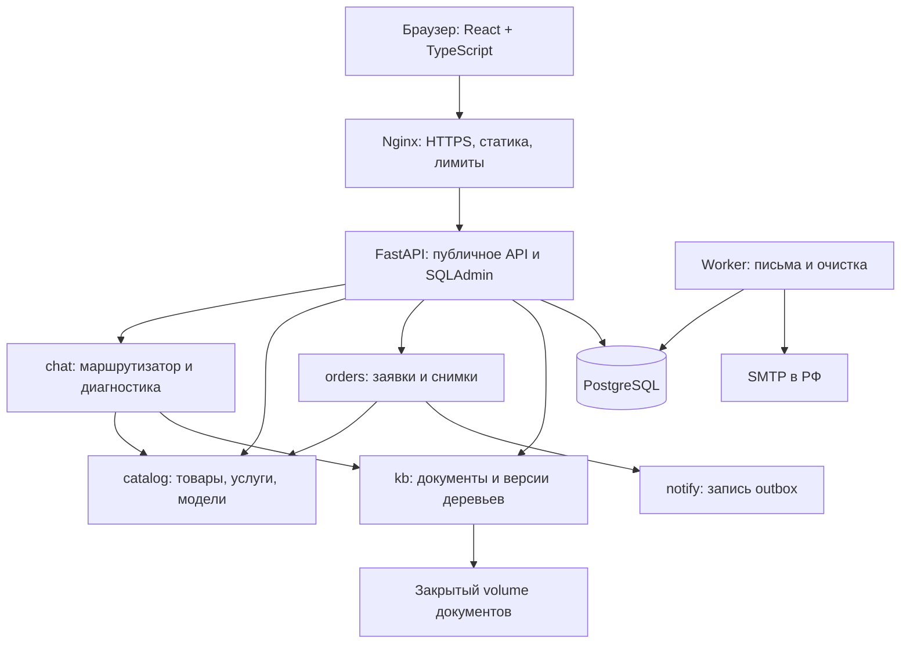

# Архитектура MVP: B2B-портал товаров, услуг и поддержки оборудования

**Версия:** 2.0, 24.10.2026. **Статус:** проект для реализации и согласования продуктовых допущений.
**Основание:** архитектура v1.0 и уточнённое задание на MVP. Упомянутая в v1.0 дорожная карта v2 от 23.10 не представлена в репозитории; её номера задач не используются как подтверждённые требования.
**Ограничения:** 3 разработчика; прототип 30.10.2026; MVP 13.11.2026; пилот около 200 пользователей; инфраструктура в РФ.
**Область:** каталог, заявки, ассистент, данные, API, минимальная админка, эксплуатация и план реализации.

Приложение ещё проектируется. Все таблицы, API, команды и каталоги ниже **предстоит реализовать**; примеры — спецификация, не существующий код. Совместимость с контрактами v1.0 не требуется. Сохранена структура основных разделов исходного документа; модель данных и контракты переработаны из-за добавления услуг, контроля доступа и безопасного жизненного цикла контента. Отдельной схемы `docs/architecture.svg` в репозитории нет: актуальная схема включена сюда.

## 0. Основные решения и результаты ревью

| Решение | Обоснование |
|---|---|
| FastAPI, модульный монолит; React + TypeScript + Vite | Общая транзакция и один backend-образ; посильный объём для трёх разработчиков |
| PostgreSQL 16: бизнес-данные, полнотекстовый поиск, outbox | Без Redis, брокера, поискового кластера и векторной БД в MVP |
| Единый `catalog_items` с `kind=product\|service` | Общие поиск, карточка, цена, позиции заявки; без дублирования CRUD и полиморфных FK |
| Заявка с несколькими позициями; КП готовит менеджер вне портала | Без оплаты, резервов, автоматического документооборота и полноценной CRM |
| Три режима ассистента: `diagnose`, `knowledge`, `commerce` | Разные источники истины и ограничения безопасности, общий интерфейс чата |
| Диагностика: утверждённые YAML-деревья, чистая функция перехода | Никаких сгенерированных технических инструкций или прямых переходов по нечёткому совпадению |
| База знаний: версии документов, фрагменты, PostgreSQL FTS | Возвращаем разрешённые цитаты и источники; LLM не нужна |
| Заявка + согласие + снимки + outbox в одной транзакции | Сбой SMTP не мешает обработке заявки в админке |
| Docker Compose: Nginx, API, worker, PostgreSQL; файлы на закрытом volume | Worker нужен для писем и очистки; файлы и БД резервируются вместе |

### 0.1 Что исправлено относительно v1.0

| Проблема | Решение в этом документе |
|---|---|
| Только детали; `shipped` не подходит услугам | Общий каталог и коммерческие статусы заявки (§5.1, §5.4) |
| Цена `test` смешана с реальной, сумма может выглядеть полной при неизвестных ценах | Только `fixed/on_request`, явная частичная сумма и статус доставки (§5.4, §7.1) |
| Индекс на отсутствующей `articles` | Один тип поисковых фрагментов `document_sections`, его FTS-индекс (§5.2, §5.7) |
| Ссылки на документ и раздел могли принадлежать разным документам | Источник указывает только на раздел неизменяемой версии документа (§5.2) |
| `tree_version` дублирует версию в `tree_id`; переходы не защищены FK | FK на конкретную версию дерева; граф валидируется целиком перед публикацией (§3, §5.3) |
| Свободный текст выбирает произвольный узел; пример предлагает проверять питание и предохранитель | Текст предлагает сценарий, переход — только подтверждённой кнопкой; опасные операции не выдаются (§3–4) |
| UUID сессии фактически давал доступ к ней | Отдельный секрет владельца, проверка доступа перед чтением и повтором (§6, §10) |
| Нет защиты от гонок и повторов | Версия состояния, блокировка строки, ключ запроса и хэш тела (§4.4, §6.1) |
| Basic Auth без ролей; CRUD мог обходить правила | Индивидуальные сотрудники, две роли; действия SQLAdmin через бизнес-сервисы (§8) |
| Outbox без восстановления зависшего `sending` | Lease, повторная обработка, семантика «как минимум один раз» (§7.2) |
| Хэш IP назван анонимизацией; сроки не покрывают заявки и копии | Политика удаления по категориям и отдельная юридическая проверка (§10) |

## 1. Контекст системы и границы MVP

### 1.1 Пользователи и основной путь

Покупатель без личного кабинета ищет оборудование, комплектующую или услугу, открывает карточку и добавляет позиции в форму заявки. Перед отправкой видит состав, известные цены, неизвестные суммы, условия доставки и согласие. После явного подтверждения сервер сохраняет заявку; менеджер видит её в админке независимо от почты, связывается с покупателем и готовит КП.

Ассистент помогает найти документацию и каталог, пройти разрешённый диагностический сценарий либо открыть форму обращения специалисту. Переход из чата только заполняет форму; не отправляет её.

| Актор | Доступ |
|---|---|
| Анонимный посетитель | Опубликованный каталог, публичные документы, собственный чат, создание заявки |
| `manager` | Заявки, смена статусов, повтор уведомлений; внутренние опубликованные документы |
| `admin` | Права manager + каталог, документы, публикация/отзыв контента, сотрудники, аудит |
| Технический эксперт | Утверждает сценарии и безопасность выдержек; публикацию выполняет admin с зафиксированным согласованием |

### 1.2 Возможности по этапам

| Возможность | MVP | После MVP | Причина |
|---|---|---|---|
| Товары и услуги, поиск, применимость к оборудованию | Да | Дополнительные характеристики и фильтры | Основа коммерческого сценария |
| Смешанная заявка, контакты, статусы, outbox | Да | Развитие процесса КП | Получение первых обращений |
| Доставка | Требуется / не требуется / согласует менеджер | API перевозчика и тарифы | Нет необходимости в интеграции для приёма заявки |
| Диагностика | 3–5 утверждённых сценариев для ограниченного набора моделей | Расширение по документам | Качество важнее охвата |
| Поиск по знаниям | Текстовые PDF и вручную подготовленные фрагменты; FTS | OCR и дополнительные форматы | Устраняет дорогое извлечение из сканов |
| Коммерческий помощник | Поиск и структурированные переходы | Персональные рекомендации | Все сведения из каталога |
| Генеративный RAG и локальная LLM | Нет | После оценки качества и безопасности | Не нужны для поиска цитат |
| Векторный поиск | Нет | При измеримом улучшении поиска | FTS достаточно для начального корпуса |
| CRM, 1С, складская синхронизация | Нет | По отдельным контрактам | Внешние зависимости и другой объём |
| Онлайн-оплата, личные кабинеты | Нет | Отдельный этап | MVP собирает заявки |
| Аналитика | Счётчики обращений, ошибок, заявок | Аналитика продаж | Нет достоверных данных о продажах в MVP |
| Редактор деревьев | YAML через git и импорт | Визуальный редактор | Не тратим время на конструктор |
| Мультиагентная система | Нет | Только при доказанной необходимости | Обычный маршрутизатор решает задачу |

### 1.3 Продуктовые допущения

До подтверждения заказчиком проектируем: одна компания, одна валюта RUB, русскоязычный интерфейс; целочисленные количества, у услуги единица «услуга/выезд», объём работ уточняет менеджер; цены предварительные, КП вне системы; точный адрес доставки при первом обращении не нужен. Нет многопользовательских организаций и индивидуальных цен. Эти допущения сокращают объём и перечислены для согласования в §16.

## 2. Логическая архитектура



Схема показывает зависимости сервисов, а не отдельные сетевые приложения. SQLAdmin — часть API. API и worker используют один образ и общие сервисы; PostgreSQL и файлы не доступны из Интернета. Внешний SMTP — единственная обязательная прикладная интеграция; его недоступность не блокирует сохранение заявки.

| Модуль | Владелец данных и интерфейсы |
|---|---|
| `catalog` | Модели оборудования, позиции, совместимость; `search`, `get_item`, `snapshot_items` |
| `orders` | Заявки, согласия, позиции, история; `create_request`, `change_status`; простое правило доставки внутри модуля |
| `kb` | Документы, фрагменты, версии деревьев; `search(actor, query)`, `get_source(actor, id)`, `load_tree`, `publish`, `revoke` |
| `chat` | Владение сессией, маршрутизация, состояние и сообщения; вызывает только read-сервисы catalog/kb; не создаёт заявку |
| `notify` | Outbox, шаблоны, retry; `enqueue` принимает существующую транзакцию orders |
| `core` | Соединения БД, конфигурация, сотрудники и сессии авторизации, аудит, лимиты, ошибки |
| `admin` | SQLAdmin и защищённые HTTP-контракты, вызывающие те же сервисы; не отдельный домен |

Запись в чужие таблицы запрещена; сервисы принимают общий Unit of Work, чтобы создание заявки и outbox было атомарным. Нет внутренних HTTP-вызовов или шины событий. Простые счётчики читают агрегирующие методы chat/orders; отдельный модуль analytics, таблица учреждений и модуль delivery в MVP не нужны. Приложение — источник актуальных опубликованных цен; менеджер отвечает за их обновление.

## 3. Диагностика как проверенный контент

### 3.1 Источник и публикация

YAML в будущем `content/trees/` — источник сценариев; git фиксирует авторство и ревью. `content/docs.yaml` сопоставляет стабильные коды документов и версии с загруженными файлами и контрольными суммами, без внутренних текстов и ПДн в публичном git.

Дерево импортируется целиком как новая `diag_trees` с уникальными `(key, version)`. Хранятся checksum YAML, commit, модель оборудования, граф JSONB, ссылки на источники и связанные позиции каталога. Это проще набора таблиц узлов/рёбер для 3–5 небольших сценариев; граф не редактируется по узлам в БД. Для проверяемых FK источники и рекомендации вынесены в отдельные связи (§5.3).

Жизненный цикл: `draft → published → retired`; `draft/published/retired → revoked`. Для одного key допускается одна published-версия; модель у всех версий key одинакова. Публикация и перевод прежней версии в retired — одна транзакция с блокировкой по key. Retired не выбирается для новых сессий, но доступна закреплённым сессиям. Revoked запрещена всем. Граф, связи и реквизиты утверждения published/retired/revoked неизменяемы; исправление — новая версия. Откат указателя на проверенную retired-версию проходит тот же контроль, отозванная версия не публикуется повторно.

### 3.2 Содержимое дерева

| Поле | Смысл |
|---|---|
| `key`, `version`, `model_code`, `title`, `start` | Идентификация сценария и начального узла |
| `nodes[node_key].type` | `question`, `result`, `handoff`; тип info в MVP не нужен |
| `text`, `source_refs[]`, `risk` | Утверждённый текст, ссылки на разделы версий документов; `observation` или `expert_only` |
| `options[]` | Стабильные `id`, текст кнопки, `next`; минимум две у question |
| `recommendations[]` | Коды товаров/услуг и предлагаемое количество; импортируются в связи |

Технические вопросы и результаты обязаны иметь источник; общие приветствия и handoff без технических утверждений могут иметь пустой список. Узел `expert_only` — только handoff с утверждённым сообщением о передаче специалисту, без операций ремонта. Пользователю доступны наблюдения за индикацией и иные отдельно утверждённые безопасные действия. Вскрытие, работа с электрическими цепями, замена внутренних предохранителей и обход защит в публичные сценарии не включаются.

В этом документе намеренно нет фиктивного «готового» дерева: реальные технические тексты, модель и ссылки утверждает эксперт на основании предоставленного руководства.

### 3.3 Валидатор и безопасность публикации

До публикации проверяются: уникальность ключей; наличие start; все переходы в пределах графа; достижимость всех узлов; отсутствие циклов (повтор начинается новой диагностикой); достижение result/handoff; source_refs существуют и относятся к опубликованным публичным версиям; рекомендации ссылаются на опубликованные позиции с подтверждённой применимостью к выбранной модели. В рантайме — максимум 30 переходов, затем handoff.

Для каждого question/result обязателен источник. JSON-schema и проверка графа выполняются при импорте и повторно в транзакции публикации. БД обеспечивает FK источников и уникальность версий, но **не доказывает безопасность текста**. Стоп-слова — дополнительный сигнал, обязательное экспертное ревью нельзя заменить CHECK-ограничением. Admin фиксирует эксперта, дату и ссылку на ревью.

Изменение видимости или отзыв источника сразу исключает его из поиска и выдачи файла и останавливает зависимые сценарии при следующем запросе. Это проверяется и для retired-деревьев, и для сохранённых ответов/повторов. Технический ответ с недоступным источником заменяется handoff, а не возвращается из старого кэша. Админка показывает список затронутых деревьев перед отзывом; отзыв безопасности не блокируется наличием активных сессий.

## 4. Ассистент и состояние диалога

### 4.1 Три режима

| Режим | Вход | Сервис / результат |
|---|---|---|
| `diagnose` | Выбор модели и симптома, затем кнопки | kb загружает закреплённое дерево; чистая функция `step(state, input, tree)` возвращает проверенный текст, источники, следующий узел |
| `knowledge` | Вопрос о документации | kb выполняет FTS с ACL; возвращает до 5 цитат, документ, раздел, страницы и ссылку |
| `commerce` | Название/артикул/услуга, необязательная модель | catalog возвращает карточки с актуальными ценами и подтверждённой применимостью |

Handoff — результат любого режима и действие открытия формы, не четвёртый движок. Режим выбирается кнопкой. Простые ключевые слова могут предложить режим или сценарий; неоднозначность вызывает меню, без тихой смены режима. В диагностике свободный текст никогда не выбирает result и не подтверждает технический шаг: выводит варианты текущего вопроса или предложение специалиста. Отсутствие связи совместимости означает «не подтверждено», а не «подходит» или «не подходит».

### 4.2 Поиск знаний

Admin загружает PDF с текстовым слоем либо UTF-8 TXT/Markdown. Извлечение выполняется ограниченной по времени/памяти командой импорта; ручная разметка и проверка фрагментов в админке обязательны. Для сканов в MVP редактор вручную вводит проверенные фрагменты с номерами страниц; OCR не устанавливаем. Ошибка извлечения оставляет документ draft и не мешает работе сайта.

Единица поиска — `document_sections`: короткий фрагмент с заголовком, section_key, диапазоном страниц и признаком разрешения для ассистента. Несколько фрагментов одного раздела получают разные section_key с сохранением названия раздела. FTS: `websearch_to_tsquery('russian', q)`, `ts_rank_cd`, GIN по `search_vector`; для артикулов используется поиск каталога. Пустой запрос не запускает поиск; отсутствие подходящих разрешённых фрагментов → «В опубликованных материалах подтверждения не найдено» + handoff. Ранг FTS не считается вероятностью правильного ответа.

ACL и статусы фильтруются **до** ранжирования, limit и total. Для анонима доступны только public + published + assistant_allowed. Внутренние сведения ищутся сотрудниками через защищённый API; публичный чат остаётся публичным даже при наличии admin-cookie. Опасные сервисные инструкции не размечаются assistant_allowed. Классификация документа как public означает, что его полный файл допустим для публичного распространения; один безопасный фрагмент не делает внутреннее руководство публичным.

Цитата не пересказывается моделью и не объявляется диагнозом. Технический вопрос об устранении неисправности предлагает диагностический режим; поиск документов не выдаёт персонализированный план ремонта. Источники вновь проверяются при открытии и восстановлении истории.

### 4.3 Коммерческие действия

`open_item`, `open_document`, `open_request_form`, `contact_specialist` — исчерпывающие типы действий. Payload содержит идентификаторы, предлагаемые количества и допустимые параметры формы, без исполняемого кода и произвольных URL. Действия проходят серверную проверку; клиент никогда не парсит текст ответа. Для каталога источником являются его записи, а не документ или LLM.

Список выбранного хранится в памяти браузера, при необходимости в sessionStorage только `{item_id, qty, revision}`. Контакты и текст чата в localStorage не сохраняются. Перед отправкой формы сервер повторно проверяет каталог. Handoff может создать заявку типа support без позиций, но тоже только после заполнения контактов и нажатия «Отправить».

### 4.4 Конкуренция и повтор сообщений

Каждое сообщение содержит `request_id` и `expected_version`. Сервис проверяет владение, блокирует строку chat_sessions, затем ищет прежний request_id. Повтор с тем же хэшем входа возвращает тот же логический результат без второго перехода (с актуальной проверкой источников); с другим телом — 409. Затем сравнивается версия: устаревшая → 409 `STATE_CONFLICT`, клиент перечитывает сессию. Сообщение, ответ и новая версия состояния сохраняются одной транзакцией. Версия увеличивается на 1. Вне транзакции нет диагностических побочных эффектов.

Смена режима сбрасывает диагностический прогресс. Выбор нового сценария закрепляет `tree_id` конкретной версии. Сервер принимает только option_id текущего узла, а не переданный пользователем next/node_id. Два параллельных запроса с одной expected_version не выполнят два перехода. Сессия доступна 24 часа с создания; после истечения — 410, возобновление старого диагностического пути запрещено.

### 4.5 Развитие

После MVP SearchService может добавить семантический поиск по тем же разрешённым фрагментам. Локальная LLM допускается для ответов по знаниям после оценки groundedness, ACL, персональных данных и ресурсов. Доступ к коммерческим данным остаётся через catalog/orders, а диагностический граф и запрет генерации опасных инструкций сохраняются. LLM не получает право создавать заявку или читать чужие обращения. Отдельной инфраструктуры под это сейчас нет.

## 5. Модель данных

Это логическая схема, не миграция. UUID v4 для PK; время `timestamptz` в UTC; деньги `numeric(12,2)`, валюта RUB; количества целые > 0. `?` означает nullable; остальные поля обязательны, если не оговорено иначе. Все ссылки ниже — FK. Удаление опубликованного контента/каталога запрещено, используется архивирование; исключение — регламент удаления ПДн. Общие created_at/updated_at подразумеваются для изменяемых сущностей.

### 5.1 Каталог

| Таблица | Поля и ограничения |
|---|---|
| `equipment_models` | id, code UNIQUE, name, description, status (`draft/published/archived`), manual_document_id? → documents |
| `catalog_items` | id, sku UNIQUE, kind (`product/service`), name, description, attributes JSONB (только отображение), unit, price_mode (`fixed/on_request`), price?, currency, tax_note, requires_shipping, status (`draft/published/archived`), revision int > 0 |
| `catalog_item_models` | item_id → catalog_items, model_id → equipment_models, evidence_section_id → document_sections; PK(item_id, model_id) |

CHECK: fixed требует price ≥ 0; on_request требует price IS NULL; service требует requires_shipping=false. Для товара requires_shipping определяется менеджером. Налоговый режим показывается текстом tax_note и не вычисляется системой. При отсутствии утверждённой цены — on_request. Тестовые цены только в изолированном демо-наборе, никогда в рабочем каталоге.

Связь с моделью означает подтверждённую совместимость товара либо применимость услуги. Сервис проверяет актуальность evidence: источник опубликован, доступен данному пользователю, модель published. Иначе API возвращает `unknown`; старую связь можно оставить для редакторского исправления. Каталог допускает позиции без привязки к модели. Любое изменение коммерческих полей и применимости увеличивает revision. В MVP нет отдельных таблиц product/service, категорий PIM, остатков, размеров и веса для расчёта перевозчика.

### 5.2 Документы

| Таблица | Поля и ограничения |
|---|---|
| `documents` | id, code UNIQUE, title, kind (`manual/regulation/article/other`), visibility (`public/internal`), status (`active/revoked`) |
| `document_versions` | id, document_id → documents, version int, file_key, mime, size_bytes, checksum_sha256, status (`draft/published/retired/revoked`), reviewed_by? → staff_users, approved_at?, published_at?; UNIQUE(document_id, version) |
| `document_sections` | id, document_version_id → document_versions, section_key, title, page_from?, page_to?, text, assistant_allowed bool, search_vector; UNIQUE(document_version_id, section_key) |

У версии один файл с неизменяемым содержимым. У документа не более одной published-версии. Файл, метаданные версии и фрагменты после публикации не редактируются; новая редакция → новая версия. Draft можно менять. Page_from/page_to либо обе null, либо 1 ≤ page_from ≤ page_to; страницы PDF — физический индекс с 1, печатную нумерацию можно включить в title. Для TXT/Markdown страницы null, section_key обязателен.

Все ссылки на знания используют section_id, из которого однозначно выводятся версия и документ. Отдельный source_document_id рядом не хранится. Источник retired-версии доступен закреплённому сценарию и по точной ссылке с отметкой «предыдущая редакция», если документ active, ACL разрешает и версия не revoked. Обычный поиск использует только published. Отзыв версии/документа перекрывает эти исключения. Публикация и отзыв транзакционны, автор и время аудируются.

### 5.3 Деревья

| Таблица | Поля и ограничения |
|---|---|
| `diag_trees` | id, key, version, model_id → equipment_models, title, graph JSONB, yaml_checksum, git_commit, status (`draft/published/retired/revoked`), expert_name?, review_reference?, published_by? → staff_users, published_at?; UNIQUE(key, version) |
| `diag_tree_sources` | tree_id → diag_trees, node_key, section_id → document_sections; PK(tree_id, node_key, section_id) |
| `diag_tree_items` | tree_id → diag_trees, node_key, item_id → catalog_items, qty; PK(tree_id, node_key, item_id) |

Graph содержит узлы и переходы; source_refs и recommendations из YAML нормализуются в две таблицы связей, не дублируются в graph. Существование node_key внутри JSON и минимум одного источника у технического узла проверяет сервис публикации, а не FK PostgreSQL. Прямой CRUD этих таблиц через админку запрещён. Приложение не имеет интерфейса обхода публикационного валидатора.

### 5.4 Заявки и согласия

| Таблица | Поля и ограничения |
|---|---|
| `consent_texts` | version PK (text), purpose, text, checksum, active_from, retired_at?; неизменяемый текст версии |
| `consents` | id, text_version → consent_texts, granted_at, channel (`request_form`), revoked_at?; создаёт сервер при подтверждённом checkbox |
| `orders` | id, number UNIQUE (из sequence), kind (`commercial/support`), organization_name?, contact_name, email?, phone?, city?, comment?, source (`site/chat`), chat_session_id? → chat_sessions, status, version int, consent_id UNIQUE → consents, idempotency_key UNIQUE, request_hash?, receipt_token_hash?, known_subtotal, items_total?, delivery_status (`not_required/pending_quote`), delivery_cost?, total_amount?, currency, created_at, updated_at, closed_at?, pii_erased_at? |
| `order_items` | id, order_id → orders, item_id → catalog_items, qty, sku_snapshot, name_snapshot, kind_snapshot, unit_snapshot, price_mode_snapshot, unit_price_snapshot?, currency_snapshot, tax_note_snapshot, requires_shipping_snapshot, catalog_revision_snapshot; UNIQUE(order_id, item_id) |
| `order_status_history` | id, order_id → orders, from_status?, to_status, changed_by? → staff_users, reason?, at; changed_by null только для создания системой |

Контакты и хэши: contact_name, request_hash, receipt_token_hash и хотя бы одно из phone/email обязательны до удаления ПДн; после pii_erased_at допускается null. Коммерческая заявка содержит 1–50 уникальных позиций с qty 1–999; support — без позиций. Предмет support описан comment либо ссылкой на текущую собственную сессию. Межтабличные правила количества позиций проверяет orders в транзакции. Consent_id клиент не выбирает: новый consent сохраняется вместе с заявкой, снимками, начальной историей и outbox. Временные метки и номер создаёт сервер.

Состав и снимки после создания неизменяемы. Удаление каталога не требуется: архивирование сохраняет FK. Изменение цены каталога не меняет заявку. `known_subtotal` — сумма известных unit_price × qty, 0 если их нет; `items_total` null при хотя бы одной неизвестной цене. Для support items_total и total_amount null. Доставка нужна, если есть product с requires_shipping_snapshot=true; тогда delivery_status=pending_quote, delivery_cost=null. Иначе not_required и delivery_cost=0. Total_amount известен только для commercial при известных items_total и delivery_cost. Неизвестное не превращается в ноль; даже полная сумма предварительная, не оферта и не выставленный счёт.

Состояния едины для товаров, услуг и support:

- `new → in_progress → closed`; `new/in_progress → cancelled`.
- closed означает завершение обработки обращения, а не оплату, отгрузку или выполнение работ. КП и согласование идут по существующим каналам компании; дата/причина закрытия фиксируются в истории.
- Для closed/cancelled reason обязателен; обратные переходы вне MVP. Любая смена требует expected_version, увеличивает version и создаёт историю в той же транзакции.

### 5.5 Чат

| Таблица | Поля и ограничения |
|---|---|
| `chat_sessions` | id, owner_token_hash, mode, tree_id? → diag_trees, current_node_key?, state_version int, outcome? (`resolved/handoff/unresolved`), created_at, last_activity_at, expires_at |
| `chat_messages` | id, session_id → chat_sessions, request_id, request_hash, input JSONB, response JSONB, state_version_after, matched_by (`button/keyword/search/none`), latency_ms, created_at; UNIQUE(session_id, request_id) |

Одна chat_messages — один атомарный обмен запрос/ответ. Response хранит структурированные actions и ссылки section_id; текст входа фильтруется до записи по §10. Результат resolved фиксируется только после явной кнопки «Помогло», не по достижению result. Создание заявки считается по orders.chat_session_id, а handoff не приравнивается к коммерческому успеху. Отдельные feedback, unanswered_questions и таблица сырых вопросов в MVP не нужны: агрегаты считают типы ответов; отбор примеров для улучшений только после ручного обезличивания.

### 5.6 Служебные данные

| Таблица | Поля и ограничения |
|---|---|
| `staff_users` | id, login UNIQUE, password_hash (Argon2id), role (`manager/admin`), is_active |
| `staff_sessions` | id, user_id → staff_users, token_hash UNIQUE, expires_at, revoked_at? |
| `audit_events` | id, actor_id? → staff_users, action, entity_type, entity_id?, at, result; без содержимого заявок/документов и секретов |
| `email_outbox` | id, order_id → orders, event_kind (`manager_notification`), status (`pending/sending/sent/failed`), attempts, next_attempt_at, lease_until?, lease_token?, last_error_code?, created_at, sent_at?; UNIQUE(order_id, event_kind) |
| `rate_limit_buckets` | scope, key_hash, window_start, count, expires_at; PK(scope, key_hash, window_start) |

Получатель уведомления — настроенный адрес менеджера. Payload письма — только номер и защищённая ссылка на админку; контакты и переписка не копируются в outbox и SMTP. Подтверждение посетителю — на экране; автоматическое письмо клиенту после MVP. Alembic создаст свою служебную таблицу версий, не бизнес-сущность.

### 5.7 Индексы и целостность

План индексов (все таблицы определены выше):

- catalog_items: UNIQUE(sku), GIN pg_trgm по name и sku, частичный индекс kind для status=published; catalog_item_models: обратный индекс (model_id, item_id).
- document_sections: GIN(search_vector), B-tree(document_version_id); search_vector вычисляется из title и text с явно заданной конфигурацией russian. document_versions: частичный UNIQUE(document_id) WHERE status=published.
- diag_trees: частичный UNIQUE(key) WHERE status=published; diag_tree_sources(section_id), diag_tree_items(item_id) для поиска зависимостей.
- chat_messages: UNIQUE(session_id, request_id), (session_id, created_at); chat_sessions(expires_at).
- orders: UNIQUE(idempotency_key), UNIQUE(number), (status, created_at DESC), (chat_session_id); order_items(order_id); order_status_history(order_id, at).
- email_outbox: (next_attempt_at) WHERE status=pending, (lease_until) WHERE status=sending; rate_limit_buckets(expires_at), staff_sessions(expires_at).

FK на версии документов и каталог — RESTRICT; дочерние фрагменты draft удаляются только сервисом после проверки ссылок. При очистке чата chat_messages удаляются CASCADE, orders.chat_session_id становится NULL. Статусы и суммы защищаются CHECK/ENUM, внешние связи — FK, правила графа/публикации/позиций — транзакционными сервисами и интеграционными тестами.

## 6. API

Базовый путь `/api/v1`. OpenAPI 3.1 формируется FastAPI при реализации; сейчас это нормативный проект контрактов. Таблица перечисляет пути относительно базового префикса, кроме health endpoints. SQLAdmin `/admin` использует те же сервисы и авторизацию.

| Метод | Путь | Контракт и доступ |
|---|---|---|
| GET | `/equipment-models` | Опубликованные модели |
| GET | `/catalog/items?q=&kind=&model_id=&limit=&offset=` | Опубликованный каталог; model_id фильтрует только подтверждённую применимость |
| GET | `/catalog/items/{id}?model_id=` | Карточка; при model_id — confirmed/unknown; draft/archived → 404 |
| GET | `/documents?kind=&limit=&offset=` | Список документов с текущей опубликованной версией, ACL |
| GET | `/knowledge/search?q=&limit=&offset=` | Разрешённые фрагменты; public для анонима, internal также для сотрудника |
| GET | `/documents/{id}/versions/{version_id}/file` | Проверяет принадлежность версии документу, ACL, статус; точная версия для цитат |
| GET | `/consent-text` | Активные version, purpose, text, checksum |
| POST | `/chat/sessions` | `{mode}` → 201 `{session_id, session_token, state_version:0, expires_at, reply}` |
| GET | `/chat/sessions/{id}` | Собственный диалог: состояние и последние 50 обменов; опциональный before для предшествующих |
| POST | `/chat/messages` | Собственная сессия, version и request_id; контракт ниже |
| POST | `/orders` | Idempotency-Key и X-Request-Token, явное подтверждение, снимки; 201 либо 200 при повторе |
| POST | `/admin/auth/login` | login/password → серверная сессия, HttpOnly cookie, CSRF-токен |
| POST | `/admin/auth/logout` | Отзыв текущей сессии |
| GET | `/admin/orders?status=&limit=&offset=` | manager/admin, список без полного comment |
| GET | `/admin/orders/{id}` | manager/admin, детали, позиции, история |
| PATCH | `/admin/orders/{id}/status` | `{status, expected_version, reason?}` → обновлённая версия и статус |
| POST | `/admin/orders/{id}/retry-notification` | failed → pending; без создания второй outbox-записи |
| GET | `/admin/stats?from=&to=` | Агрегаты без текстов и контактов |
| GET | `/healthz`, `/readyz` | Вне `/api/v1`: жив процесс / доступна БД и совместима схема |

CRUD каталога, загрузка/импорт документов, review/publish/revoke и управление сотрудниками реализуются формами SQLAdmin; отдельное дублирующее REST CRUD API для них не требуется. Маршруты всех форм защищены сервером, не только скрыты в меню. Импорт YAML — административная команда с теми же сервисами; нет публичного endpoint загрузки YAML.

### 6.1 Общие правила

Ошибка: `{"error":{"code":"STATE_CONFLICT","message":"Состояние изменилось","details":{"current_version":3}},"request_id":"…"}`. Коды HTTP: 401 — нет авторизации, 403 — роль/CSRF, 404 — объект отсутствует или недоступен, 409 — конфликт состояния/цены/ключа, 410 — истекшая собственная сессия, 422 — невалидное тело, 429 — лимит с Retry-After, 503 — инфраструктурная ошибка. Детали не раскрывают существование чужого объекта.

Время ISO 8601 UTC; денежные значения строками или null; массивы всегда массивы. Пагинация `{items,total,limit,offset}`, limit по умолчанию 20, максимум 100 (для knowledge максимум 5), offset максимум 10000. Пустой результат — 200 с items=[], без неподтверждённого ответа. Текстовый запрос до 1000 символов. Поля, не входящие в контракт записи, отклоняются, включая клиентскую цену и произвольный статус.

Для создания заявки браузер генерирует Idempotency-Key (UUID) и отдельный случайный X-Request-Token (256 бит), сохраняет их в sessionStorage до окончания запроса. В БД — только хэш токена. Одинаковые ключ, токен и канонический хэш тела возвращают исходный безопасный receipt; другое тело с тем же ключом и верным токеном → 409 `IDEMPOTENCY_CONFLICT`; неверный токен → общая 404. Параллельные вставки разрешает UNIQUE в PostgreSQL, проигравшая транзакция читает итог победившей. Request_hash — HMAC тела серверным ключом, не простой хэш контактов. Повтор проверяется до текущих цен и текста согласия, не создаёт вторую заявку/согласие/письмо. Без ключа или токена — 422.

Ключ живёт до удаления строки заявки, хэши — до удаления ПДн; гарантия повторов заявлена на 24 часа. Receipt восстанавливается из неизменяемых снимков и номера с исходным status=new, без чтения текущего статуса обработки и без отдельной таблицы ответов. Receipt не содержит контактов. После удаления ПДн повтор → 410 без выдачи данных. Публичного GET заявки по номеру или UUID нет. После потери токена восстановление только через менеджера с проверкой личности; номер заявки не является секретом доступа.

### 6.2 Карточка и поиск

Карточка: `{id, sku, kind, name, description, attributes, unit, price_mode, price, currency, tax_note, requires_shipping, revision, applicability}`. Applicability при указанной модели: `{model_id, status:"confirmed"|"unknown", sources:[]}`; без модели — null. Sources содержат доступные SourceRef, формат ниже. Search возвращает краткую карточку без длинного description и attributes.

Результат knowledge: `{items:[{excerpt, source}], total, limit, offset}`. SourceRef: `{section_id, document_id, document_version_id, title, section, page_from, page_to, url}`; url генерирует сервер для защищённого file endpoint. Null-страницы допустимы. HTML из документа никогда не вставляется как доверенная разметка.

### 6.3 Сообщение ассистенту

Тело: `{session_id, request_id, expected_version, input}`. Заголовок `X-Chat-Token` содержит секрет сессии. Input — одно из:

- `{type:"text", value:"…"}`;
- `{type:"select_mode", mode:"diagnose"|"knowledge"|"commerce"}`;
- `{type:"start_diagnosis", model_id, tree_key}` (сервер выбирает published-версию);
- `{type:"button", option_id:"…"}` из текущего reply;
- `{type:"feedback", useful:true|false}` после result.

Ответ: `{message_id, state_version, reply:{mode,text,buttons:[],sources:[],items:[],actions:[],resolution}}`. Resolution: `question`, `results`, `no_match`, `handoff`, `completed`. Buttons содержат `{id,label,input}`; сервер валидирует их по текущему состоянию. Для выбора сценария используются buttons с input=start_diagnosis; отдельный публичный API графов не нужен. Actions — `{type,payload}`: open_item содержит item_id, open_document — SourceRef, open_request_form — kind и items, contact_specialist — kind=support. Ни одно action не выполняет POST orders автоматически.

Числовой confidence удалён: без калиброванной модели он вводит в заблуждение. UI показывает resolution и варианты уточнения, а не вероятность диагноза. Коммерческие карточки и открываемая форма перечитывают актуальный каталог; старые сообщения не обещают сохранения цены.

### 6.4 Создание заявки

Тело коммерческой заявки:

```json
{
  "kind": "commercial",
  "items": [{"item_id": "UUID", "qty": 2, "expected_revision": 3}],
  "contact": {"name": "Имя", "email": "buyer@example.org"},
  "organization_name": "Организация",
  "city": "Город",
  "comment": "Нужно коммерческое предложение",
  "source": "site",
  "consent": {"version": "VERSION", "accepted": true},
  "confirmed": true
}
```

Значения UUID/VERSION — placeholders, не загруженные справочные данные. Support использует kind=support, items=[]; comment обязателен, если нет chat_session_id. Source=chat требует chat_session_id и X-Chat-Token; сервер проверяет владельца и срок, иначе не сохраняет связь. Source=site не принимает chat_session_id. Контакты до 200 символов, email до 254, phone до 32, comment до 2000; проверяются форматы и общий размер тела. Город запрашивается только при физической доставке и может быть уточнён менеджером.

Сервер сначала разрешает повтор по ключу, затем проверяет подтверждение и действующую версию согласия. В транзакции блокирует выбранные позиции в стабильном порядке, проверяет published и revision, читает цены, делает снимки и суммы. Несовпадение → 409 `CATALOG_CHANGED`, клиент обновляет обзор и просит подтвердить его заново с новым ключом; согласие изменилось → 409 `CONSENT_CHANGED`. Заблокированные позиции нельзя одновременно изменить до сохранения снимков. После COMMIT возвращается receipt:

`{number,status:"new",known_subtotal:"2400.00",items_total:null,delivery_status:"pending_quote",delivery_cost:null,total_amount:null,currency:"RUB"}`.

Здесь known_subtotal может быть частичным; UI явно пишет «известная часть стоимости» и «доставка/остальные цены уточняются». Ошибка SMTP после commit не меняет ответ. До commit ошибка откатывает все записи. Подтверждение не означает договор или оплату.

## 7. Интеграции

### 7.1 Доставка

В MVP нет СДЭК, фальшивого тарифа и endpoint `/delivery/calc`. Расчёт состоит в определении необходимости доставки по товарным позициям; числовую стоимость согласует менеджер вне системы. Услуги не добавляют вес, тариф и адрес доставки. Расходы на выезд специалиста — часть согласования услуги, не доставка товара. В следующем этапе DeliveryService принимает только требующие перевозки товары, сохраняет снимок котировки и срок действия; недоступность провайдера оставляет pending_quote. Добавлять кэш и API заранее не нужно.

### 7.2 Email outbox

В транзакции orders создаётся ровно одно manager_notification. Worker выбирает due-записи через `FOR UPDATE SKIP LOCKED`, устанавливает sending, attempts+1, lease_token и lease_until (2 минуты), коммитит, отправляет письмо вне транзакции с SMTP timeout 20 секунд. Результат записывается только при совпадающем lease_token. Просроченный sending возвращается в pending; после пяти попыток — failed. При возврате просроченного lease также проверяется лимит попыток. Задержки повторов: 5, 30, 120, 720 минут. Admin/manager видит failed и может повторить отправку с аудитом, сбросом attempts в 0 и немедленным next_attempt_at; sent и действующий sending повторять вручную нельзя.

SMTP не обеспечивает exactly-once: сбой после отправки до записи sent может дать дубликат. Стабильный Message-ID снижает неудобство, но не гарантирует дедупликацию у получателя. Номер заявки в письме позволяет узнать повтор; сама заявка остаётся единственной. Backlog и возраст старейшего pending наблюдаются. Работа менеджера через админку — основной канал, почта — уведомление.

## 8. Административная панель

SQLAdmin внутри FastAPI: минимальные формы каталога, моделей/применимости, версий документов и фрагментов; список заявок, карточка, статусы и outbox; публикация/отзыв; сотрудники только для admin. Выбрана готовая админка, чтобы не писать второй React-интерфейс.

Нельзя включать generic CRUD для orders, consents, outbox, diag_trees и опубликованных версий: изменения только через явно разрешённые сервисные действия. Менеджер не видит редакторские и пользовательские формы, а прямой HTTP-запрос к ним получает 403. Публикация диагностического сценария требует записи экспертного согласования. Первого admin создаёт локальная административная команда, без публичной регистрации и пароля по умолчанию.

Нет скачивания всех контактов, конструктора CRM, редактора деревьев, произвольного редактирования снимков и удаления истории через UI. Законное удаление/отзыв ПДн выполняет отдельная защищённая процедура с аудитом (§10), а не запрет удаления навсегда.

## 9. Нефункциональные требования

| Цель пилота | Проверка перед запуском |
|---|---|
| Около 200 пользователей; ориентир 30 одновременно | Короткий нагрузочный прогон на целевой машине |
| p95: диагностическая кнопка ≤ 300 мс, поиск ≤ 800 мс, создание заявки ≤ 1 с | Время API без SMTP и загрузки файлов; зафиксировать объём тестового корпуса |
| Один сервер, ориентир 4 vCPU / 8 GB RAM + SSD | Подтвердить нагрузкой и размером документов; это начальная оценка, не измеренный минимум |
| RPO ≤ 24 ч, RTO ≤ 4 ч | Восстановление БД и файлов в чистое окружение, замер времени |
| Наблюдаемость | Ошибки API, latency, DB connections, возраст outbox, свободный диск, результат backup |

Один API-процесс для начала, один worker; параллелизм увеличивается по измерениям. Лимиты по сессиям хранятся в PostgreSQL, поэтому корректны и при нескольких процессах. Доступность и сроки реакции на инциденты требуют договорённости об ответственном; одноузловой Compose не обещает HA.

## 10. Безопасность и персональные данные

### 10.1 Авторизация и доступ

Staff login: Argon2id, случайная серверная сессия, cookie Secure + HttpOnly + SameSite=Strict, срок 8 часов; logout/отключение сотрудника отзывает доступ. Проверка роли и is_active на каждом запросе. Все изменяющие admin-запросы защищены CSRF и проверкой Origin; CORS только same-origin. IP-ограничение админки — дополнительная мера, не замена логину.

Chat token — 256 случайных бит, возвращается один раз и хранится клиентом в sessionStorage; сервер хранит хэш. X-Chat-Token обязателен для всех операций с сессией и связи её с заявкой. UUID не секрет. Токены никогда не передаются в URL/логах. CSP, экранирование контента и запрет сторонних скриптов снижают риск кражи через XSS. Публичный чат не наследует внутренние права admin. Файлы — через endpoint с проверкой ACL на каждый запрос; закрытый volume не раздаётся как статика. Внутренние файлы, чат, заявки и ответы с токенами имеют Cache-Control: no-store.

Лимиты: Nginx 120 запросов/мин на IP к API, login 5/мин; PostgreSQL — 30 сообщений/мин на сессию, создание сессий 10/час на IP, создание новых заявок 5/час на IP. IP за доверенным Nginx, произвольный X-Forwarded-For не принимается. Ключ лимитера — HMAC IP с вращаемым ключом, окна удаляются не позднее 24 часов; это псевдонимизация. Повтор существующей заявки не расходует лимит новых заявок, но общий лимит HTTP действует. Для учреждений с общим NAT лимиты уточняются по пилоту.

### 10.2 Файлы и секреты

Загрузка только admin: PDF/TXT/Markdown, magic bytes + MIME + расширение, максимум 25 МБ; архивы, HTML и исполняемые файлы запрещены. Серверное случайное file_key; пути пользователя не используются. Файл сначала в карантине, проверка локальным ClamAV с актуальными сигнатурами перед публикацией; парсер запускается без сети, непривилегированно, с лимитами памяти/CPU/времени. До успешной проверки и ревью файл не выдаётся. Обновление сигнатур выполняет оператор по проверяемому каналу; отсутствие актуальной проверки блокирует публикацию файла. Владелец процесса назначается до пилота.

Выдача с Content-Disposition: attachment и nosniff; строки Markdown отображаются без raw HTML. SSRF отсутствует по дизайну: импорт по произвольному URL не поддерживается. Для удаления осиротевших файлов — регламент после проверки ссылок и резервных копий.

Секреты SMTP, HMAC и пароли БД только в защищённых runtime-файлах/секретах сервера, не в git, образе и выводе CI. Ротация и резервное хранение ключей отдельно от данных; смена ключа HMAC учитывает время жизни повторов заявок. TLS, минимальные DB-права, внутренние контейнерные сети, регулярные обновления зависимостей. Хостинг БД, файлов, SMTP и backup — в РФ; мониторинг не получает тексты, контакты и тела запросов.

### 10.3 Минимизация и сроки

Предлагаемые сроки для пилота требуют юридического утверждения до сбора реальных данных; это не установленные законом универсальные сроки.

| Данные | Предлагаемое хранение / удаление |
|---|---|
| Контакты, комментарий и организация заявки | До 180 дней после closed/cancelled; открытые старше 180 дней пересматривает ответственный |
| Чат: вход, ответы, ссылки на сессии | 30 дней; доступ посетителя 24 ч; затем удаление сообщений и сессии, FK в заявках → NULL |
| Согласие и версия текста | Вместе с заявкой, доказательство основания хранения на более долгий срок — только по согласованной политике |
| Обезличенные коммерческие снимки заявки | 1 год после закрытия, затем удаление; номера и агрегаты не содержат контактов |
| Аудит без содержимого, технические логи | 90 / 14 дней соответственно |
| Sent/failed outbox | 30 дней после завершения, затем удаление; pending старше суток — сигнал оператору |
| Резервные копии | 14 дней, шифрование и отдельный доступ; плановый срок истечения |

В чате предупреждение не вводить ПДн; контакты собирает отдельная форма. Перед записью input маскируются типовые email/телефоны; свободный текст всё равно считается потенциально персональным, автоматическая маскировка не доказывает анонимность. В логах нет request/response bodies, cookie, заголовков токенов, query q и свободных reason. Для регрессионного корпуса — только вручную очищенные примеры, не production-выгрузка.

Очистка заявки удаляет контакты, comment, organization_name, city, свободные reason в истории, связь с чатом, хэши повторов и токен; ставит pii_erased_at. Согласие удаляется вместе с конечной записью заявки, либо раньше по подтверждённому основанию через процедуру, согласующую FK и хранение доказательств. Правила удаления всей строки используют CASCADE для позиций/истории/outbox и удаление связанного consent в одной транзакции. Нельзя называть оставшиеся связуемые данные анонимными без оценки.

Worker ежедневно выполняет пакетную очистку с аудитом количества. Запрос на удаление/отзыв обрабатывает ответственный после проверки личности; основания дальнейшего хранения определяет оператор. Нельзя автоматически удалять обязательные доказательства или бессрочно сохранять всё «для аналитики». Перед открытием восстановленной копии повторно применяют журнал исполненных удалений, хранящий только технические идентификаторы отдельно от backup не менее 14 дней; выбывшие данные не возвращаются пользователям.

### 10.4 Что проверяется отдельно по 152-ФЗ

Заказчик/юрист определяет оператора и обработчиков, цели и правовые основания обработки (включая чат), тексты политики и отдельного согласия, сроки/порядок отзыва, необходимость уведомления Роскомнадзора, локализацию и трансграничные потоки, поручения подрядчикам, модель угроз/уровень защищённости, организационные меры и порядок инцидентов. Хостинг в РФ, хэш IP и checkbox не являются подтверждением полного соответствия. Без согласованных документов реальный пилот не открывается; разработка и демо идут на синтетических данных.

## 11. Развёртывание, зависимости и CI/CD

Docker Compose: nginx (TLS и frontend static), api, worker (тот же backend-образ), postgres:16 и закрытый volume файлов. Сканер загрузок запускается локальным процессом при импорте; не отдельный поисковый/очередной сервис. Бэкап отправляется в отдельное защищённое хранилище в РФ; production и тестовые данные разделены. Staging на том же сервере допустим только с отдельными volume/секретами, ограничением ресурсов и без копии реальных контактов.

| Зависимость | Зачем в MVP |
|---|---|
| FastAPI / Pydantic / Uvicorn | HTTP-контракты и валидация |
| SQLAlchemy / psycopg / Alembic | PostgreSQL, транзакции, миграции |
| SQLAdmin, Argon2-библиотека | Готовые формы и индивидуальная авторизация |
| PyYAML (safe loader), JSON-schema validator | Импорт и проверка графов без исполнения YAML-тегов |
| pypdf и ClamAV (локальная утилита) | Текст PDF и обязательная проверка загружаемых файлов; без отдельного постоянно работающего сервиса, сканы размечаются вручную |
| PostgreSQL pg_trgm и встроенный FTS | Поиск каталога и документации без дополнительного сервиса |
| React / TypeScript / Vite | Пользовательский интерфейс; одна сборка статики |

Конкретные версии фиксируются lockfiles в первой задаче реализации. Нет rapidfuzz, эмбеддингов, LLM-фреймворка, Celery, Redis, MinIO и Sentry в обязательном наборе. Для SMTP достаточно штатной библиотеки; worker — небольшой цикл с устойчивыми состояниями БД.

CI после появления кода: backend lint/types/unit + интеграционные тесты на PostgreSQL, frontend typecheck/build, проверка контента и контрактов. Миграции — отдельный одноразовый шаг до запуска приложения; ошибка останавливает деплой. Версии образов фиксируются тегом/дижестом. До первого выпуска совместимость со старым кодом не требуется; после пилота изменения схемы планируются с сохранением реальных заявок и проверенным откатом.

Ежедневный backup: pg_dump и согласованный набор неизменяемых файлов. Во время снимка блокируются публикация и удаление файлов; сначала фиксируется БД, затем все файлы, на которые она ссылается, с манифестом checksum. Восстановление до 13.11 проверяет таблицы, FK, выдачу документов и непрерывность номеров; исходящие письма в восстановленном стенде выключены. Одна копия на том же VPS не считается резервированием.

## 12. Проверка реализации и критерии приёмки

Ниже план будущих тестов, **не утверждение об уже выполненной проверке приложения**. БД в интеграционных тестах — PostgreSQL.

| Область | Критерий |
|---|---|
| Каталог | Товар, услуга, fixed/on_request; отсутствующая применимость → unknown; архивное скрыто; данные берутся из БД |
| Заявка | Смешанные позиции, service-only, support; неизвестная цена/доставка не дают ложной полной суммы; клиентская цена отвергается |
| Снимки | Изменение каталога до отправки → 409; после создания не меняет состав/цену заявки |
| Атомарность | Ошибка на любом шаге транзакции не оставляет частичную заявку/consent/outbox |
| Идемпотентность | Двойной клик и параллельный POST дают одну заявку/письмо; смена тела → 409, чужой токен не раскрывает receipt |
| SMTP | Недоступность не блокирует заявку; crash после отправки, истёкший lease, failed и ручной retry; допускается повтор письма |
| Диагностика | Все пути каждого дерева; неизвестная модель, неизвестный option_id, нерелевантный текст → уточнение/handoff; нет перехода к result по свободному тексту |
| Публикация | Граф с неверными ссылками/циклом/без источника не публикуется; новая версия не меняет активную сессию, отзыв останавливает её |
| Конкуренция чата | Два запроса одной версии — один переход; повтор request_id не меняет состояние; смена режима сбрасывает граф |
| ACL | Чужая сессия/заявка недоступна; internal не попадает в anonymous snippets/total/file/history; revoked не возвращается при повторе сообщения |
| Поиск знаний | Не менее 20 согласованных вопросов: для ≥80% найден релевантный разрешённый фрагмент в top-5; 20 нерелевантных/опасных запросов не дают выдуманных инструкций |
| Сотрудники | manager не публикует контент; прямые URL проверяют роли; CSRF, logout, отключение пользователя |
| Файлы / ПДн | Невалидный формат/размер/путь отвергаются; текст и секреты не попадают в логи; очистка затрагивает все копии в рабочей БД |
| Сквозное демо | Поиск услуги и товара → форма → заявка → админка → смена статуса; поиск цитаты → файл; диагностика → форма специалиста |
| Эксплуатация | Нагрузочный smoke, HTTPS, backup/restore, повторная очистка после восстановления |

Показатель поиска — цель приёмки, не гарантированный результат FTS. При нехватке качества сначала улучшаем заголовки, разметку и словарь предметных терминов; не добавляем LLM автоматически. Утверждение технического эксперта обязательно отдельно от автоматических тестов.

## 13. Планируемая структура репозитория

Сейчас основной артефакт — этот документ. Следующие пути **планируются**, команды ещё не существуют:

```text
backend/
  app/
    core/
    modules/{catalog,orders,kb,chat,notify}/
    admin/
    worker/
  migrations/
  tests/
frontend/
content/
  trees/
  docs.yaml
docker-compose.yml
Makefile
```

Планируемые команды: up, migrate, seed (только тестовые данные), kb-check, kb-import, test, lint. Команды импорта повторяемы: тот же key/version/checksum — без изменений, иной checksum с тем же номером версии — ошибка. Файлы реальных документов и их runtime-метаданные не коммитятся автоматически. Новые ADR вынесем в отдельные файлы, только когда появятся дополнительные спорные решения; ключевые решения уже зафиксированы в §15.

## 14. Реалистичный план для трёх разработчиков

Даты — 2026 год. Прототип 30 октября и MVP 13 ноября оставляют 15 календарных будней с 26 октября; при российском производственном календаре 4 ноября — выходной, остаётся 14 рабочих дней и сокращённый день 3 ноября. План не предполагает обязательную работу в выходные; объём этапа 02–06.11 учитывает этот резерв времени. Контент и согласования предоставляет заказчик/технический эксперт; это внешняя зависимость, не четвёртый разработчик.

| Период | Разработчик 1: backend / коммерция / инфраструктура | Разработчик 2: ассистент / знания | Разработчик 3: frontend / интеграция |
|---|---|---|---|
| 26–27.10 | Compose, БД, модель каталога/заявки, auth-каркас, согласование OpenAPI | Формат дерева, валидатор, ACL документов, образцы контента | Каркас UI, типы контракта, каталог/форма на контрактных mock-данных |
| 28–30.10 | Каталог, атомарная заявка и outbox, список в админке | Один утверждённый сценарий, сессия и кнопки, поиск нескольких фрагментов | Поиск → смешанная форма → подтверждение; чат и цитаты; интеграционное демо |
| 02–06.11 | Статусы, снимки/конкуренция, роли, retry, защищённые формы | Импорт/публикация/отзыв, FTS, 3–5 сценариев, связи каталога | Полный путь из чата в форму, ошибки/повторы, адаптивность, источники |
| 09–11.11 | Удаление ПДн, backup/restore, мониторинг | Регресс безопасности, corpus поиска и устранение ошибок | Сквозная приёмка, доступность UI, браузерные проверки |
| 12–13.11 | Совместно: исправления блокеров, freeze, проверка staging, релиз пилота | Экспертное утверждение final-контента | Финальное демо и инструкция менеджеру |

**Критический путь:** согласование модели/API → каталог и форма → транзакционная заявка → админка → сквозная приёмка. Параллельный критический путь диагностики: документы и эксперт → валидатор/источники → утверждённые деревья → безопасный runtime → регресс. UI и backend синхронизируются по контракту до независимой реализации.

Демо 30.10: минимум один товар и одна услуга, заявка с обоими типами, её видимость в админке при выключенном SMTP, одна цитата и один безопасный сценарий. Если документа нет, демонстрируется только handoff; синтетический сценарий допустим исключительно в закрытом демо с маркировкой и не считается готовой диагностикой.

Если сроки срываются: сократить ассортимент, число моделей и сценариев; PDF-разметку сделать вручную; убрать необязательные агрегаты и декоративные элементы. Нельзя снимать ACL, транзакционность, источники, экспертное утверждение, контроль повторов и восстановление backup. Отсутствие утверждённых материалов означает **сокращённый коммерческий пилот без диагностики**, а не выполнение всех требований. Такое изменение объёма отдельно согласуется и явно отражается в приёмке.

## 15. Краткие архитектурные решения

| Решение | Альтернатива и причина отказа | Путь развития |
|---|---|---|
| Один каталог с kind | Раздельные products/services дублируют контракты; универсальная PIM чрезмерна | При необходимости detail-таблицы 1:1 к стабильному item_id |
| Orders — обращения с неизменяемым снимком | Полный заказ со складом/оплатой не соответствует MVP | КП, договор и исполнение отдельными сущностями, связанными с исходной заявкой |
| YAML + immutable JSONB-граф и FK источников | Нормализация каждого ребра усложняет импорт малого графа | Визуальный редактор использует тот же валидатор и формат |
| FTS и цитаты | Векторная БД и генерация пока не оправданы | SearchService получает второй индекс с тем же ACL и SourceRef |
| Состояние/очередь в PostgreSQL | Redis/Celery добавляют эксплуатацию | Менять только при измеренном ограничении; бизнес-сервисы сохраняются |
| SQLAdmin внутри FastAPI | Отдельная React-админка забирает frontend-поток | Специализированные экраны поверх тех же сервисов |
| Доставка по согласованию | СДЭК и тестовые цены не нужны для приёма обращений | Provider-адаптер, снимок котировки, отдельный согласованный этап |

Отдельная альтернатива Django из v1.0 удалена: FastAPI задан ограничением, повторный выбор фреймворка не помогает реализации. Обязательная LLM-классификация и правило «никогда не генерировать никакие ответы» заменены точной границей: в MVP генерации нет, безопасная генерация по знаниям возможна позже; техническая диагностика остаётся детерминированной.

## 16. Остаточные риски, согласования и проверка согласованности

| Риск / допущение | Что требуется |
|---|---|
| Не предоставлены руководства/права на публикацию | Заказчик передаёт файлы, версии, список публичного/внутреннего; без них нет готовой диагностики |
| Не назначен эксперт | Утвердить ответственного и срок review до 06.11; разработчики не подтверждают безопасность инструкций самостоятельно |
| Один каталог и целочисленный объём услуг | Подтвердить достаточность единицы «услуга/выезд», отсутствие тарифного калькулятора |
| RUB, налоговая пометка, цена по запросу | Подтвердить ценовую политику, кто обновляет цены и что входит в КП |
| Доставка/КП/работы согласуются вне портала | Подтвердить ручной процесс, получателя уведомлений, ответственного менеджера и срок реакции |
| Support без позиций | Подтвердить, что обращения специалисту обрабатывает та же команда, что коммерческие заявки |
| Внутренние материалы только сотрудникам | Клиентский доступ по организациям требует будущих кабинетов и отдельной ACL-модели |
| Правовые основания и сроки ПДн | Утвердить §10 и тексты до реального сбора данных, назначить обработку запросов удаления |
| Качество FTS и ручная разметка | Проверить на реальном корпусе; расширение форматов не скрывать в сроках MVP |
| Один сервер и доставка писем с повторами | Принять ограничение доступности, назначить backup/инциденты, проверить SMTP и восстановление |
| Узкий срок | Сначала сквозной коммерческий путь; сокращение контента оформляется открыто (§14) |

### 16.1 Матрица согласованности проектного решения

| Сценарий | Данные | API / сервис | Проверка |
|---|---|---|---|
| Товар + услуга в заявке | catalog_items → order_items → orders | catalog/items, POST orders | Снимки, mixed/service-only, revision conflict |
| Диагностика → специалист | diag_trees + sources → chat_sessions → orders(kind=support) | chat/messages → форма → POST orders | Подтверждение, источник, владение сессией |
| Документация → цитата/файл | documents → document_versions → document_sections | knowledge/search, version file endpoint | ACL до limit, точная версия, отзыв |
| Обработка заявки без почты | orders + history + email_outbox | admin/orders и status | SMTP down, lease/retry, отсутствие дубля заявки |
| Смена версии/отзыв | immutable версии, закреплённый tree_id | publish/revoke сервисы | Retired разрешена закреплённой сессии; revoked запрещена даже при replay |
| Удаление данных | ПДн заявки, сообщения, согласия, копии | Защищённая процедура и worker | Сроки, FK, восстановление без возврата удалённого |

Проверка документа выполнена на уровне проектных контрактов: все индексируемые таблицы определены; источники однозначны; роли, статусы, действия и режимы согласованы с API; инфраструктура не требует LLM и брокеров; будущие пути помечены как планируемые. Реальные схемы, нагрузка, юридическое соответствие и безопасность технических текстов потребуют отдельных проверок при реализации. Этот документ не заменяет их результатов.
