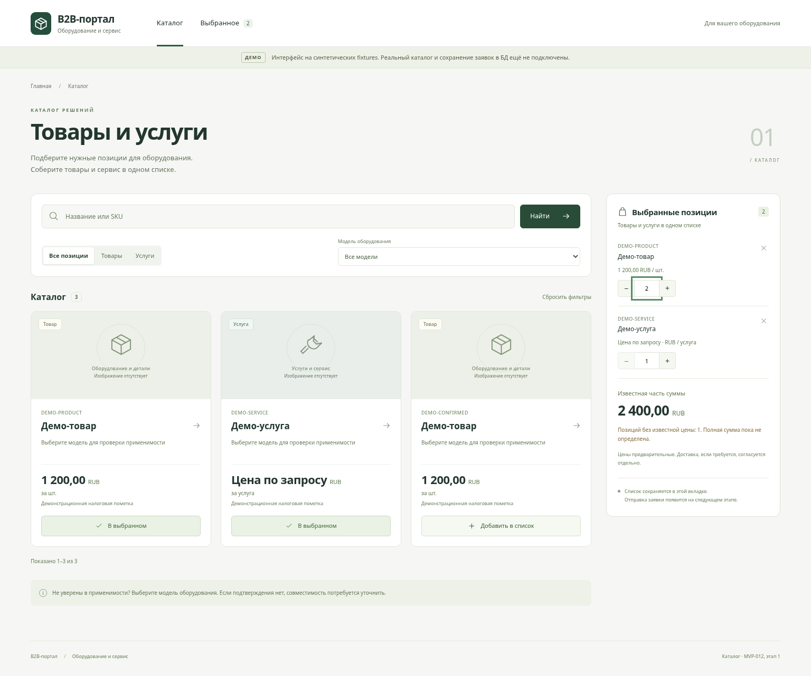
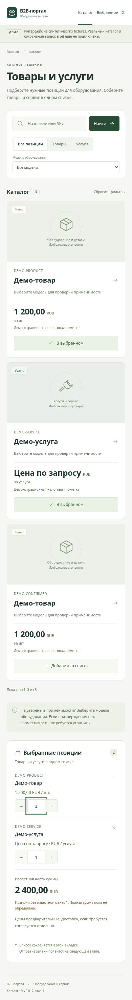

# MVP-012 — Frontend каталога, этап 1: fixtures

Статус: **реализован первый UI-этап, MVP-012 целиком не завершена**.
База: `main`, `ee78882bd5330ca9ef82dffdddaa23b87af8870c` (MVP-002 включён).
MVP-007 отсутствует; интеграционная приёмка по PostgreSQL/Compose отложена
до следующего этапа. Рабочий сценарий сейчас использует только утверждённые
синтетические fixtures. Постоянный баннер сообщает это пользователю.

## Реализовано

- `pages/CatalogPage`: поиск, product/service, модель, pagination, навигация
  к выбранному, адаптивный desktop/mobile layout.
- `pages/ItemDetail`: отдельное получение описания, цены, единицы, налоговой
  пометки и применимости для текущей модели. Отсутствующее описание fixture
  отмечено явно, новые бизнес-данные не добавлены.
- `components/CatalogCard`, `ItemImage`, `ItemFacts`, `StatusPanel`:
  краткие карточки, decimal-цены и цена по запросу, confirmed/unknown,
  безопасная заглушка и loading/empty/error с повтором.
- `components/SelectedItems`: смешанный список, qty 1–999, удаление,
  защита от повторного добавления; частичная сумма без floating point,
  неизвестная цена/недоступная позиция не считается нулевой.
- `state/selection`: только item_id/qty/revision в sessionStorage;
  нормализация и очистка восстановления, работа при отказе storage.
  Данные/цены перечитываются по ID, изменение revision явно показано.
- `api/fixtureCatalog` отделён от `api/httpCatalog`; HTTP-клиент подготовлен
  для трёх согласованных GET-маршрутов, без fallback на fixtures.
- UI-тесты включены в существующий frontend job GitHub Actions. Остальные
  jobs и их шаги сохранены. Backend, миграции, Compose, architecture и
  implementation plan не менялись.

## Ограничения fixtures

В утверждённом `catalog_page` три позиции: два товара и услуга.
Детальное описание утверждено только для `catalog_item`; для остальных
адаптер возвращает пустые description/attributes. Поиск — простое
регистронезависимое вхождение name/SKU, а не PostgreSQL pg_trgm.
Применимость берётся из fixtures: список с model_id содержит только
confirmed; detail услуги с этой моделью показывает unknown. Без model_id
applicability нормализуется в null согласно §6.2.

Единственный image_url пока не обслуживается backend: браузер проверяет
ошибку загрузки и показывает заглушку. Ни GET каталога из БД, ни POST orders
не выдаются за работающие. Отправки заявки и фиктивного receipt нет.

## Проверки

Локально в облачной среде, Node 24.19.0 / npm 11.9.0:

- `npm ci` — установка из закреплённого lockfile.
- `npm test` — 49 тестов: поиск/name/SKU, оба kind, модель и unknown,
  цены/налоги/unit, детали, null/broken/unsafe image, mixed selection,
  qty/удаление/дубликаты, storage/перезагрузка/лишние поля/invalid rows,
  актуальные цены/revision, загрузка/пустой ответ/ошибки/повтор,
  устаревший async-ответ, экранирование, пагинация, точная арифметика;
  HTTP paths/queries, статусы 404/422/429/503, malformed JSON/shape/price.
- `npm run typecheck` и `npm run build` — успешно.
- Chromium (Playwright из среды, не новая зависимость репозитория): смешанный
  список, qty=2, reload с восстановлением, detail услуги с unknown;
  без JavaScript page errors. Проверены ширины 320/390/768/1024/1536 px —
  горизонтального переполнения нет. Это проверка UI на fixtures,
  **не E2E-приёмка с реальным API/PG через Compose**.
- Статусы и ссылка на прогон GitHub Actions записываются в описании PR
  после проверки опубликованного коммита.

Desktop, 1536 px:

Mobile, 390 px:

## Остаток после MVP-007 до полного DoD MVP-012

1. Заменить fixtureCatalog в composition root на httpCatalog; удалить
   fixture-зависимость из рабочего сценария и пересмотреть демо-баннер.
   Сохранить fixtures только для изолированных тестов/демо.
2. Проверить GET моделей, поиска/списка и detail с реальным PostgreSQL:
   published-only, q/name/SKU (pg_trgm), kind/model, total/limit/offset,
   decimal/null, налоговые пометки, revision и отсутствие скрытых данных.
3. Проверить выбранные ID при перезагрузке и изменении каталога:
   текущие цены, изменённые revision, unavailable/archived/draft и удаление;
   связать дальнейшее подтверждение с MVP-013 без доверия клиентской цене.
4. Подтвердить реальное отображение HTTP/network ошибок, пустых результатов,
   повторов и отмены/устаревших ответов; до MVP-024 проверить ожидаемый unknown,
   а до MVP-025 image_url=null и заглушку, без выдуманных подтверждений/картинок.
5. Выполнить отдельный browser E2E через действующий Compose (MVP-055)
   с настоящими API/PG: поиск → детальная карточка → смешанный список →
   qty/удаление → reload. Network должен показывать реальные GET-маршруты,
   fixtures не должны подменять ответы. Сценарии отправки относятся к MVP-013.
6. Зафиксировать CI/E2E-результаты и доказательства интеграции в отдельном PR;
   закрывать MVP-012 только после выполнения этих пунктов и полного DoD.

Автоматический merge не выполняется; этот PR остаётся открыт для ревью.
