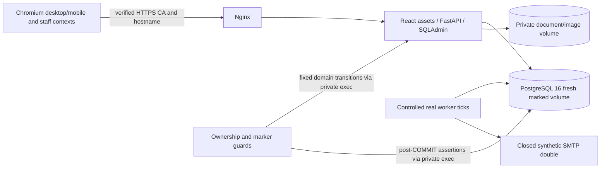

# MVP-046 — сквозная browser E2E приёмка

Base: `465c1da68b3cede8bdd7434161f86fe9737473d5`. Branch:
`mvp-046-browser-e2e-acceptance`. Exact final HEAD and workflow URLs belong
in [Draft PR #59](https://github.com/h1roshigoto/akbrizcase/pull/59) and each `MVP046_EVIDENCE` record (a commit cannot contain its own SHA).

## Inventory before implementation

| Journey | Existing coverage | Missing link | New E2E | Required evidence |
| --- | --- | --- | --- | --- |
| A commercial → manager → worker | request-form, catalog-admin, notification-retry | Retry suite creates its own order by API; separate stacks | A/E in mvp046-e2e | React mixed order, real lost 201, SQLAdmin same receipt, PG snapshots/history, actual SMTP failure/retry, no business writes |
| B knowledge → file → withdrawal | live-chat, files_smoke, MVP-045 | Browser citation/download and subsequent lifecycle change in one environment | B | exact version, bytes/SHA256/headers, current/history/replay ACL after COMMIT |
| C diagnose → support → manager | live-support, live-chat | Feedback/adversarial input, commercial selection isolation and exact manager comment linked together | C/E | real UI, no automatic order, exact comment, consent/FK/history after chat deletion |
| D image/applicability | catalog-media, catalog-admin, MVP-045 | Images and internal evidence permission on the same ordered positions | D | SQLAdmin forms, list/detail/fallback, current keys, internal source absence, revoke changes total/status |
| E conflicts/network/expiry/limits | request-form, live-support, http-security | Preserved open input and genuine rate-limit recovery alongside A–D | E | real 409/410/429, fresh explicit review, exact retry credentials and committed counts |

The new runner must keep all modules in one fresh labelled PG16/files stack,
using the checked-out frontend/backend, verified localhost HTTPS, React,
SQLAdmin, real ClamAV/Pillow with explicitly synthetic signatures, and a closed
SMTP double. It must never orchestrate independent existing smoke entry points
as a substitute for these links. Existing standalone smokes remain mandatory.

## Admission boundaries

`LOCAL_SYNTHETIC_E2E: BLOCKED` — Docker VFS ENOSPC before browser startup.
`CI_SYNTHETIC_E2E: PASS` — two complete independent fresh stacks on verified
`ef63589fd24718ffb20cd5c5d88e23ddfbec2a58`; all eight jobs passed.
The final report-only commit and its exact-HEAD rerun are tracked in Draft PR #59.
`TARGET_STAGING_E2E: BLOCKED`: no target server/domain/TLS, authorized full
profile, operator access or customer/expert approvals supplied. Reduced
MVP-041 release mode remains unchanged. Real PII, production SMTP, deployment,
MVP-047–050 and merge are outside this task. Synthetic search matches prove
no expert-corpus relevance. Synthetic diagnostic trees and review packets
prove no safety approval for real equipment.

Remaining gates: real content rights and expert reviews; legal/privacy policy,
retention/deletion decisions; signed CVD supply and monitoring; RF hosting,
SMTP and secret custody; independent production recovery/RPO/RTO; operator and
customer pilot authorization. No synthetic PASS closes those gates.

## Implementation and checkpoints

Only Nginx loopback ingress is published. PostgreSQL/API/worker/SMTP and storage
are private. All catalog/orders/chat/knowledge/admin/image paths are enabled
only in this marked synthetic demo profile; worker SMTP targets only the double.
Real-data admission, real SMTP and production signed-CVD readiness are not
established by this profile. Reduced MVP-041 mode gates are preserved.

`make mvp046-browser-e2e` builds the current checkout, claims fresh labelled
volumes, migrates PostgreSQL 16, verifies the synthetic marker and seeds only
through the established synthetic/domain pipelines. Browser/SQLAdmin actions
and fixed domain transitions use one system. The closed SMTP double has no
published ports; worker ticks use the real lease/transport/backoff implementation.
Document delivery uses the same test-only real ClamAV composition as images;
the production signed-CVD gate is unchanged.

Fifteen mandatory checkpoint IDs: `A.desktop`, `A.mobile`, `B.desktop`,
`B.mobile`, `C.desktop`, `C.mobile`, `D.images`, `D.applicability`, `E.409`,
`E.410`, `E.429`, `E.network-before`, `E.network-after`, `keyboard.desktop`,
`keyboard.mobile`. Missing/duplicate checkpoints, missing receipts or unexpected
final writes fail the runner. `MVP046_EVIDENCE` contains only HEAD, case IDs,
counts, PG version, duration and the external gate. It is emitted only after
all mandatory browser and database assertions, not from test collection.

| Scenario | Observed order/consent/item/outbox/history delta per successful stack | Evidence asserted |
| --- | --- | --- |
| A.desktop | 1 / 1 / 2 / 1 / 2 | lost real committed 201, exact manual 200 replay, SQLAdmin snapshots, status actor/version/history, worker failed→protected retry→actual SMTP sent |
| C.desktop | 1 / 1 / 0 / 1 / 1 | permitted model/scenario, forged/free input denied result, feedback, edited exact description, no POST on open, witnessed chat cleanup, FK NULL and manager comment |
| A.mobile | 1 / 1 / 2 / 1 / 2 | consent/price changes give actual 409, preserved fields, explicit review/reacceptance; first order snapshots unchanged |
| C.mobile | 1 / 1 / 0 / 1 / 1 | same support/feedback/cleanup/manager path at 390×844 |
| B / D | 0 / 0 / 0 / 0 / 0 | exact file download/checksum/headers; internal fact permission via SQLAdmin; revoke/history/replay; image upload/replace/failure/remove/fallback/archive; full business-row equality |
| E expiry / pre-send disconnect | 1 / 1 / 0 / 1 / 1 | own 410, preserved fields, explicit fresh site review/secrets, no chat header/FK; abort before transmission, exact manual retry, genuine 201 then original 200 |
| Total | **5 / 5 / 4 / 5 / 7** | one sent + four pending outbox, five distinct receipts; no duplicate writes |

These postconditions were checked after real COMMIT in both successful stacks
listed below. Desktop is 1280×800; mobile is
390×844. Both commercial and support mandatory fields/confirmations/submission
use keyboard traversal. Focus, labels, Tab/Shift+Tab, Space/Enter, errors,
Back/Forward, double-click guard, receipt visibility and overflow are checked.
This is application acceptance, not a formal WCAG audit.

The message quota is filled using real authenticated requests behind Nginx;
forged X-Forwarded-For does not grant capacity. Recovery advances only the owned
synthetic session's existing quota window after the observed 429. Rates and
production rate-limit configuration are unchanged; resubmission remains explicit.

Actual API boundary inherited from MVP-045: commerce has no model input and
returns applicability=null. Model-specific confirmed/unknown and total are
checked in catalog; this suite must not invent a model-aware commerce contract.

## Defect and validation ledger

Fixed: chat query text was cleared before the server answered. A real 429 would
lose the input. Chat now retains the draft on error, explicitly explains the
rate limit, keeps current context and performs no automatic retry. A component
regression proves retained text and exactly one call before explicit continuation.
Successful text submission still clears the accepted draft.

Local results (implementation checkout; capacity limits are not PASS):

| Command | Result |
| --- | --- |
| `make backend-test` | 1009 PASS, 32.50 s in the serial run |
| `make backend-lint`, `make backend-types` | PASS, 223 typed files |
| `npm --prefix frontend test` | 219 PASS, 13 files, 30.78 s |
| `make frontend-typecheck frontend-build` | PASS |
| `uv run --locked python -m app.contracts.export_types --check` (backend) | PASS |
| `make acceptance-guards` | 50 PASS, including missing/duplicate journey and corrupt-count negatives |
| `make config`, `make local-tls` | PASS |
| `make build` with session CA mount | PASS before later source changes; not final acceptance |
| New E2E attempts | BLOCKED before browser: build CA omission, then Docker VFS ENOSPC; no complete browser PASS |

Initial overlapping backend/frontend/build checks produced one backend import
timeout and five frontend timeouts. Serial execution passed without changing
any assertion or deadline. The cloud-specific optional build CA is now passed
through a BuildKit secret mount. No TLS verification was disabled. Ordinary
builds do not require that optional cloud variable.

Docker started empty (zero images/containers/volumes). Only this task's build
cache was reclaimed after ENOSPC; no volumes or existing data were removed.
Full PG16 regression and prior browser runs require a runner with enough disk;
they remain mandatory in the unchanged seven CI jobs. A separate eighth job
runs the new controller twice on independent fresh stacks at the exact PR HEAD,
with a 20-minute outer budget; existing Compose timing/assertions are unchanged.
Measured timing/results are below. Final report-only HEAD/run/job links are
maintained in the Draft PR without inventing a self-referential commit SHA.

All input is synthetic, contacts use `.invalid`; credentials are transient.
Raw browser errors, SQL output, bodies, contacts, cookies, tokens, HAR, traces
and screenshots are not uploaded. Only safe stage locations and aggregates
are printed on failure. The existing final private log/audit scan includes
API/Nginx/PG/worker/SMTP and checks the observed authentication/contact material.
A failed or unexecuted scan is not evidence of absence of leaks.

Changed files: workflow, Makefile, browser media test composition, chat page and
controller, chat UI regression, shared HTTPS/SMTP harness helpers, new linked
browser/controller/domain fixture/evidence guards, and this report. No migration,
release-mode enablement or business-domain rewrite; the Nginx canonical response header fix is described below.

First exact-HEAD CI attempt (`03eb44ab0c16485a56d3b1acd1b4e760e7ebacea`,
run [42360128043](https://github.com/h1roshigoto/akbrizcase/actions/runs/42360128043)):
new suite **FAIL** at B.desktop, 101.53 s. Actual checkpoints passed:
keyboard.desktop (zero writes), lost committed response/replay (1/1/2/1/1),
A.desktop including worker/status (1/1/2/1/2), C.desktop including witnessed
cleanup/manager (2/2/2/2/3). Root cause: new browser assertion expected the quote
without the existing knowledge response's heading and numbered citation prefix.
The assertion now compares the exact established full text; no API behavior or
security predicate was changed. The failure is not counted as a full E2E PASS.
Also tightened outbox identity equality and moved aggregate PASS emission after
the final private log/audit scan. Next exact-HEAD CI must verify the whole suite.

Second attempt (`627887d0ad5417d2ebd46891be860f8e8721cb27`,
[run 42360390735](https://github.com/h1roshigoto/akbrizcase/actions/runs/42360390735)):
**FAIL**, B.desktop, 90.78 s; same four preceding checkpoints passed.
The remaining B failure is under investigation: granular citation/file/download
stage and source-line diagnostics are added without disclosing browser errors.
HTTP file headers/checksum are checked before the actual browser download to
separate delivery failure from browser event observation. Subsequent changes
also explicitly cover commercial Back/Forward, manager mobile viewport, matching
internal-search exclusion and deterministic SQLAdmin navigation completion.

Third attempt (`821690ae8fa3a23661951e4bfe26499c9fbf442e`,
[run 42360673607](https://github.com/h1roshigoto/akbrizcase/actions/runs/42360673607)):
**FAIL**, B.file-http.desktop, 78.72 s. This localized failure to the file
security-header assertion, before browser download. Configuration analysis found
that API middleware and Nginx both added X-Content-Type-Options, yielding duplicate
nosniff fields at the proxy. Nginx now hides the upstream copy and emits exactly
one canonical nosniff, including error responses. The same small fix applies to
HTTP, HTTPS, packaged default and reduced release Nginx configurations; no release
mode/rate/admission/scanner setting is enabled or relaxed. Existing HTTPS auth and
HTTP security smokes now assert a single effective header, in addition to the
strict file assertion in B. Next CI verifies actual corrected delivery.

Additional linked checks: real chat expected_version 409 followed by explicit
button choice; original commercial receipt replay after consent/price/image/
archive changes; unchanged business rows across each domain content mutation;
unchanged outbox identity across notification retry. These add no extra orders.

Fourth attempt (`b8236ca004281810b8e89999e01c9f08ad978ce8`,
[run 42361085189](https://github.com/h1roshigoto/akbrizcase/actions/runs/42361085189)):
**FAIL**, quota-recovery harness assertion, 105.84 s. Both A/C viewports,
commercial Back/Forward, keyboard, actual consent/price/staff/chat conflicts,
and both exact browser file downloads/security headers/checksums passed before
failure. Nginx header correction is thus exercised. Actual 429 and retained
query were observed. Root cause: psql `UPDATE … RETURNING` includes the `UPDATE 1`
command tag; comparing its stdout with just `30` was wrong. Recovery now uses a
CTE and SELECT asserting exactly one moved row with used=30. No rate threshold,
retry, HTTP success or business invariant is relaxed. Nginx `-t` also passed
locally for all four changed configurations in networkless read-only containers.

Fifth attempt (`76145e38216b9b2bad5e276c4111d98e6f7f6bea`,
[run 42361392429](https://github.com/h1roshigoto/akbrizcase/actions/runs/42361392429)):
**FAIL**, D.applicability visible filtered count, 115.51 s. E.429 including the
real quota, retained text and explicit continuation now passed. Next diagnostic
adds a committed prerequisite join and observes the actual browser model-filter
HTTP response before asserting its rendering, retaining the one-item requirement.

Sixth attempt (`da3d5fa203b7709af0d2e0c1c3068ac576f22686`,
[run 42361803015](https://github.com/h1roshigoto/akbrizcase/actions/runs/42361803015)):
**FAIL**, E.429 refresh control availability, 101.85 s; prior A/C checkpoints
passed. The unpaced quota burst mixed the session quota with the unchanged shared
Nginx budget and reused a window opened earlier in B. The quota case now owns a
fresh session and paces each real request at 650 ms, below 120/minute ingress,
within the original 60-second message window. A new direct PG assertion requires
used=30 with a live window, so an edge 429 cannot masquerade as message quota.
The UI refresh's actual HTTP status is asserted before further actions. This is
bounded request scheduling, not retry-until-success or a timeout/rate change.

Seventh attempt (`49828405a2100b613427bac8becb9065c0ee743d`,
[run 42362173992](https://github.com/h1roshigoto/akbrizcase/actions/runs/42362173992)):
**FAIL**, archive public HTTP assertion, 179.33 s. E.429 and D.applicability now
passed, including committed prerequisites, one model-filtered HTTP/UI result,
internal privacy, revoke/unknown and zero total. JPEG/PNG, replace, invalid-upload
rollback and list/detail fallback were exercised before the archive read failed.
To keep this acceptance distinct from a multi-client load test, every synthetic
actor's initial API/admin request now shares a 650-ms ingress scheduler. Browser
requests continue to the real backend; APIRequestContext uses the same scheduler.
No rejected request is automatically retried, no status is replaced and no rate
or timeout changes. Archive DB state is checked before the actual public status,
whose closed numeric code is included in failure stage diagnostics. Current
commerce/replay is also checked after evidence revoke and product archive.

Eighth attempt (`a096a18110d2020ad368224476d785ab4d0eb419`,
[run 42362833582](https://github.com/h1roshigoto/akbrizcase/actions/runs/42362833582)):
**FAIL**, first keyboard helper, 65.27 s, zero orders. Scheduling exposed a
harness assumption: visible consent text was treated as readiness although
policy/catalog requests could still be queued. Keyboard traversal now waits for
both confirmations to become enabled, preserving the existing fail-closed UI.
Unexpected asynchronous routing failures are sanitized and counted as failures;
normal navigation aborts/cleanup cannot print raw transport diagnostics. No
browser form success or certificate/CSRF/publication predicate is substituted.

Ninth attempt (`4c241e4cc1d045c6a891fc06156402205267ec08`,
[run 42363227785](https://github.com/h1roshigoto/akbrizcase/actions/runs/42363227785)):
**FAIL at final storage guard**, 373.52 s. All 15 mandatory checkpoint actions
and final 5/5/4/5/7 business counts actually passed, including D images/archive,
current commerce/replay, B withdrawal and E expiry/pre-send retry. There is still
no overall PASS. Root cause: attachment links with target=_blank leave an opaque
about:blank download popup; reading localStorage there raises SecurityError.
The harness now closes only popups created by that exact completed download,
then requires all eight application tabs to have the expected origin and empty
localStorage. It does not skip any application tab's storage check. The final
candidate also restores a current knowledge citation before revoke, in addition
to checking history/replay, and explicitly observes visible keyboard validation.

## Confirmed synthetic acceptance

Verified application/test implementation:
`ef63589fd24718ffb20cd5c5d88e23ddfbec2a58`.
[Exact-HEAD run 42363954544](https://github.com/h1roshigoto/akbrizcase/actions/runs/42363954544)
completed **8/8 SUCCESS**. Both commands completed without retrying a failed run.
The only following change is this evidence document; the final exact-HEAD rerun
is linked and maintained in [Draft PR #59](https://github.com/h1roshigoto/akbrizcase/pull/59).

| Fresh project | Full `make mvp046-browser-e2e` | Controller/browser stage | Actual result |
| --- | ---: | ---: | --- |
| `akbrizcase-https-test-36d5c17fd3` | 379.29 s | 323.67 s | 15/15 checkpoints; PASS after final private log/audit scan |
| `akbrizcase-https-test-1e6bf50071` | 371.94 s | 323.92 s | 15/15 checkpoints; PASS after final private log/audit scan |

Both used PostgreSQL `16.13 (Debian 16.13-1.pgdg12+1)`, schema
`0011_mvp039_http_security`, different fresh labelled DB/files volumes and
transient secrets. Both retained their own volumes after shutdown. Each produced
5 distinct receipts; **5 orders, 5 consents, 4 items, 5 outbox, 7 history**;
one sent and four pending notifications. No duplicate write set after replay.
The 20-minute new-job budget covers the measured 751.23 s for the two complete
commands plus tooling/setup, without changing any previous job or inner deadline.

| User journey | Desktop | Mobile | Actual linked result |
| --- | --- | --- | --- |
| A | PASS | PASS | Mixed product/service → explicit submission → same SQLAdmin order → status/history/actor → real worker failure/retry/send; immutable snapshots and original receipt |
| B | PASS | PASS | Exact quoted citation → actual browser attachment → bytes/SHA256/MIME/disposition/nosniff → source withdrawal → current reply/history/replay/file denial; original raw JSONB retained |
| C | PASS | PASS | Published synthetic diagnosis → forged/free input cannot skip result → feedback → edited confirmed support → witnessed chat cleanup → exact manager comment/history and FK NULL |
| D | PASS | PASS | SQLAdmin fact review/publication; public confirmed without internal IDs/title/text/source; revoke gives unknown/zero total; current commerce reprojects revisions; JPEG/PNG/replace/failure/remove/fallback/archive |
| E | PASS | PASS where the journey applies | Genuine consent/price/staff/chat 409; own 410 with explicit new site review; real session 429 and manual continuation; before-send loss and lost committed response with exact retry, no extra writes |
| Keyboard | PASS | PASS | Commercial and support mandatory fields, Tab/Shift+Tab, Space/Enter, validation/focus/labels, confirmations and explicit submit; no accidental/double submission |

The file links' completed about:blank download popups are closed as their own
transient resources. Every one of the **eight application tabs** then passed
same-origin and empty-localStorage assertions. No unexpected browser/routing
error, observed contact/authentication canary in browser console or application,
proxy, PostgreSQL, worker, SMTP logs/audit was found by the private final checks.
No screenshots, HAR, traces, raw HTTP bodies, tokens or cookies were uploaded.
Only synthetic `.invalid` contacts were created; no real personal data was used.

### Preserved jobs on the verified implementation

| Job | Result and exact job |
| --- | --- |
| Backend checks | [SUCCESS](https://github.com/h1roshigoto/akbrizcase/actions/runs/42363954544/job/128378030590): 1009 tests in 21.96 s, lint/types |
| Frontend checks | [SUCCESS](https://github.com/h1roshigoto/akbrizcase/actions/runs/42363954544/job/128378030394): 219 tests/13 files in 11.51 s, types/build |
| PostgreSQL 16 integration | [SUCCESS](https://github.com/h1roshigoto/akbrizcase/actions/runs/42363954544/job/128378030509): all dispatcher suites and real files; safe test inventory retained |
| Compose build and smoke | [SUCCESS](https://github.com/h1roshigoto/akbrizcase/actions/runs/42363954544/job/128378030570): all former smokes, including new strict HTTP/HTTPS header regressions |
| Encrypted PG16 backup and clean restore | [SUCCESS](https://github.com/h1roshigoto/akbrizcase/actions/runs/42363954544/job/128378030587): 10 files, 30 FK, 6 deletion replays; admission/SMTP closed; production recovery remains BLOCKED |
| Synthetic staging release rehearsal | [SUCCESS](https://github.com/h1roshigoto/akbrizcase/actions/runs/42363954544/job/128378030774): existing reduced profile only |
| Synthetic operator handover rehearsal | [SUCCESS](https://github.com/h1roshigoto/akbrizcase/actions/runs/42363954544/job/128378030496): all eight operator stages; human handover/production BLOCKED |
| New linked browser E2E | [SUCCESS](https://github.com/h1roshigoto/akbrizcase/actions/runs/42363954544/job/128378030709): two independent complete runs above |

Full PG dispatcher timings include core 416.99 s, images 321.65 s, lifecycle
145.40 s, applicability 70.13 s, trees 80.30 s, chat 54.68 s, HTTP security
57.50 s, **commercial regression 75.54 s**, **ACL/publication regression 215.47 s**,
real ClamAV/sandbox 148.81 s (119 actual file tests), build/clean-upgrade 36.81 s.
Groups retain the existing two-stack scheduler and inventory; no new case is
silently substituted for or double-counted as an old pytest case.

Existing Compose suite durations (all PASS): smoke 79.65 s; worker/SMTP 134.30 s;
catalog browser 39.79 s; chat 29.18 s; HTTPS auth 29.78 s; support 37.54 s;
privacy 37.63 s; vertical 57.86 s; status 61.73 s; catalog admin/media 56.30 s;
notification retry 45.73 s; HTTP security 36.21 s. Every former browser command
ran on this exact implementation; none was removed for the new suite's budget.

### Explicit unavailable/local-only checks

Local full `make integration-ci`, standalone `make commercial-regression` and
`make acl-publication-regression`, and prior full Docker/browser smokes were
**NOT RUN to completion locally** after the demonstrated VFS ENOSPC. The exact
CI `make integration-ci` did execute both complete named regression groups in
fresh owned PG16 stacks. This is not a claim that the standalone local command
succeeded. Canonical CI `make build` succeeded on the verified implementation;
the earlier local build is historical evidence only. Local Nginx `-t` passed
for HTTP, HTTPS, packaged default and release configs; contracts exporter
`--check`, config, TLS generation, backend/frontend checks and 50 safety guards
passed as listed above. Earlier timeout/CA/ENOSPC/harness failures are recorded
in the ledger; they are not retroactively labelled PASS. New scenarios had no
skip/xfail or retry-until-success. The existing PostgreSQL core skips for tests
executed by their dedicated upgrade/backup jobs remain unchanged.

No known unresolved P0/P1 application defect remains in these successful
synthetic paths. Local disk capacity is an unresolved infrastructure limitation.
**The full staging/pilot DoD is not closed**: target staging, real corpus expert
approval/rights, legal decisions, signed production CVD supply, real SMTP/secret
custody, independent production restore and human/pilot authorization remain
BLOCKED. Required target input: owner-authorized full RF synthetic staging,
domain/TLS/firewall, isolated storage/secrets and operator/admin/manager access,
enabled-mode record, and the responsible content/legal/operations approvals.
Do not send secrets in chat. No merge, deployment or MVP-047–050 work occurred.

## Files in the PR

- `.github/workflows/ci.yml`
- `Makefile`
- `backend/tests/browser_media_server.py`
- `docs/MVP-046-browser-e2e-acceptance.md`
- `frontend/nginx.conf`
- `frontend/src/chat/ChatPage.tsx`
- `frontend/src/chat/controller.ts`
- `frontend/src/test/chatUI.test.tsx`
- `frontend/tests/http-security.mjs`
- `frontend/tests/https-auth.mjs`
- `frontend/tests/mvp046-e2e.mjs`
- `infrastructure/nginx.conf`
- `infrastructure/nginx.https.conf`
- `infrastructure/release/nginx.conf`
- `scripts/https_smoke.py`
- `scripts/mvp046_browser_smoke.py`
- `scripts/mvp046_fixture.py`
- `scripts/notification_retry_browser_smoke.py`
- `scripts/test_mvp046.py`
